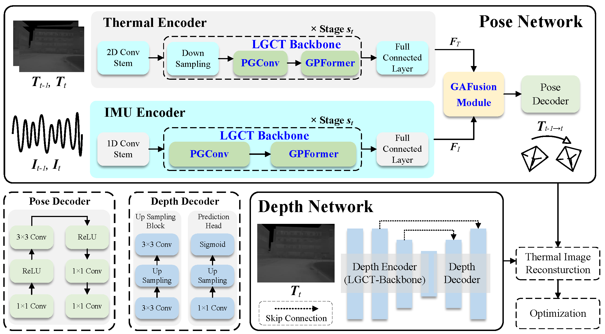
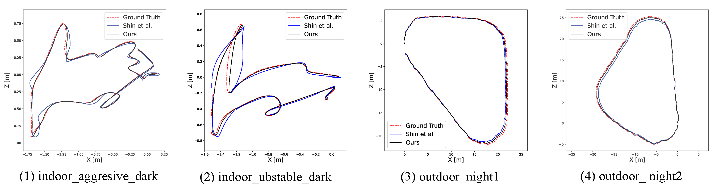

# LiteTIO

LiteTIO is a lightweight thermal-inertial odometry framework for robust camera pose estimation in low-light and visually degraded environments. The project contains training and evaluation code for self-supervised thermal image, inertial, depth, and pose learning.

## Highlights

- Lightweight thermal-inertial pose estimation network.
- Self-supervised training with photometric, smoothness, and geometry consistency losses.
- ViViD++ compatible dataloaders and pose evaluation utilities.
- Example qualitative videos included in `media/`.

## Demo

<p align="center">
  <video src="media/video_pred_xyz2_static_gt.mp4" controls width="720"></video>
</p>

<p align="center">
  <a href="media/video_pred_xyz2_static_gt.mp4">View pose prediction demo video</a>
</p>

<p align="center">
  <video src="media/video_traj_as_ours.mp4" controls width="720"></video>
</p>

<p align="center">
  <a href="media/video_traj_as_ours.mp4">View trajectory demo video</a>
</p>

## Architecture

<p align="center">
  
</p>

<p align="center">
  
</p>

## Project Structure

```text
LiteTIO/
|-- common/
|   |-- loss/
|   |-- models/
|   `-- utils/
|-- dataloader/
|-- eval_vivid/
|-- media/
|-- train.py
`-- test_pose.py
```

## Installation

This codebase was developed with Python 3.8, PyTorch 1.12.1, CUDA 11.3, and Ubuntu 20.04.

```bash
conda create -n litetio python=3.8 -y
conda activate litetio
pip install -r requirements.txt
```

`torch-geometric` must match your PyTorch and CUDA versions. If `pip install -r requirements.txt` cannot resolve the correct wheel, install it from the official PyG instructions for your environment.

## Dataset

Download ViViD++ from the official dataset website:

- https://sites.google.com/view/dgbicra2019-vivid/

Prepare the post-processed training data in the same layout expected by `dataloader/`.

The default training path is:

```text
./common/data_prepare/dump
```

You can override it with `--data`.

## Training

```bash
python train.py \
  --data ./common/data_prepare/dump \
  --name litetio_vivid \
  --scene_type outdoor \
  --batch-size 48 \
  --epochs 200
```

Training logs and checkpoints are written to:

```text
checkpoints/<experiment_name>/
```

To monitor training:

```bash
tensorboard --logdir checkpoints/
```

Then open `http://localhost:6006`.

## Evaluation

```bash
python test_pose.py \
  --dataset-dir /path/to/vivid \
  --sequences outdoor_robust_night1 \
  --pretrained-posenet /path/to/pose_encoder_checkpoint.pth.tar \
  --pretrained-pose /path/to/pose_decoder_checkpoint.pth.tar \
  --pretrained-imu /path/to/imu_encoder_checkpoint.pth.tar \
  --pretrained-fusion /path/to/fusion_checkpoint.pth.tar \
  --output-dir outputs/pose
```

## References

- [ViViD++ dataset](https://sites.google.com/view/dgbicra2019-vivid/)
- [ThermalMonoDepth](https://github.com/UkcheolShin/ThermalMonoDepth)
- [ThermalSfMLearner-MS](https://github.com/UkcheolShin/ThermalSfMLearner-MS)
- [Lite-Mono](https://github.com/noahzn/Lite-Mono)
- [MambaOut](https://github.com/yuweihao/MambaOut)

## License

This repository is prepared for open source release. Choose and add a license before publishing if your target license is not already included.
